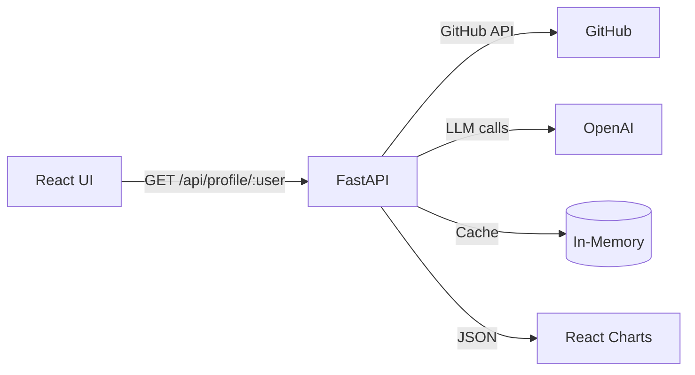

# AI-powered GitHub Repository Analyzer

[](#)
[](LICENSE)
[]()

## Description
An interactive tool to analyze GitHub profiles and repositories using FastAPI, React, and OpenAI.  
Generates language breakdowns, star/fork trends, activity heatmaps, README quality scores, keyword suggestions, and a simple AI chat interface.

## Features
- **Profile Overview**: Avatar, bio, followers, public repos, pinned repos  
- **Language Breakdown**: Pie/bar charts with usage percentages  
- **Star & Fork Trends**: Sorted time-series or top-N lists  
- **Activity Heatmap**: Push activity by date  
- **README Analysis**: LLM-generated summary, suggestions, readability score, missing sections  
- **Keyword Extraction**: Top-5 README keywords via LLM  
- **Simple Q&A Chat**: One-turn AI chat on any repository context  

## Architecture


## Tech Stack
- **Backend**: Python 3.11, FastAPI, HTTPX, OpenAI Python SDK v1.x  
- **AI**: OpenAI `gpt-4o-mini` (chat completions)  
- **Cache**: In-process `asyncio.Lock`-guarded dict with 10-minute TTL  
- **Frontend**: React 18, Axios, Chart.js, react-chartjs-2  
- **Testing**: pytest (backend)  
- **Deployment**: Docker, Render

## Installation

```bash
git clone https://github.com/aniketkarne/AI-Powered-Github-Repo-Analyzer.git
cd AI-Powered-Github-Repo-Analyzer
```

### Backend

```bash
cd backend
python -m venv venv
source venv/bin/activate
pip install -r requirements.txt
cp .env.example .env   # then fill in your tokens
uvicorn app.main:app --reload
```

### Frontend

```bash
cd frontend
npm install
npm start
```

## Environment Variables

Create a `.env` file in `backend/`:

```env
GITHUB_TOKEN=ghp_your_token_here
OPENAI_API_KEY=sk-your_openai_key_here
```

The backend will start without either token — endpoints that need them will return a clear `401`/`404` instead of crashing at boot.

## API Endpoints

### Profile & Trends
- `GET /api/profile/{username}`  
  Response: `{ profile, repos, language_breakdown, star_trend, fork_trend, heatmap }`

### README Analysis
- `GET /api/profile/{username}/readme-report`  
  Response: `{ reports: [ { repo, analysis } ] }`

### Repos only
- `GET /api/profile/{username}/repos`  
  Response: `{ repos: [ ... ] }`

### Health
- `GET /health`  
  Response: `{ "status": "ok" }`

## Running Tests

```bash
cd backend
pip install pytest pytest-asyncio
pytest
```

## Contributing
1. Fork the repository  
2. Create a feature branch (`git checkout -b feature/XYZ`)  
3. Commit changes (`git commit -m "Add feature XYZ"`)  
4. Push (`git push origin feature/XYZ`)  
5. Open a Pull Request

Please follow code style guidelines and add tests for new features.

## License
This project is licensed under the MIT License — see [LICENSE](LICENSE).